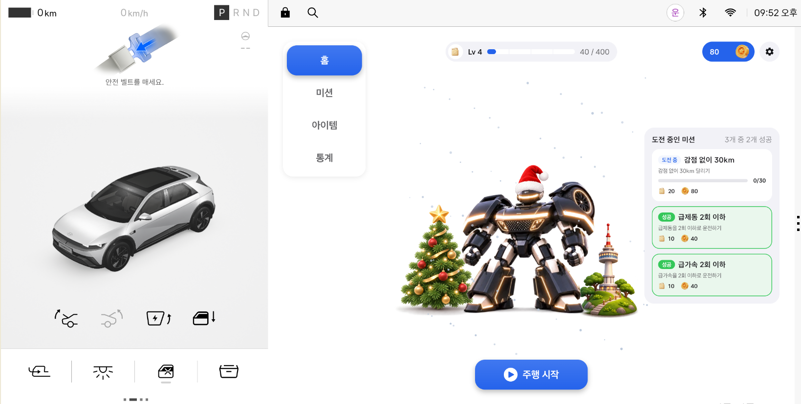
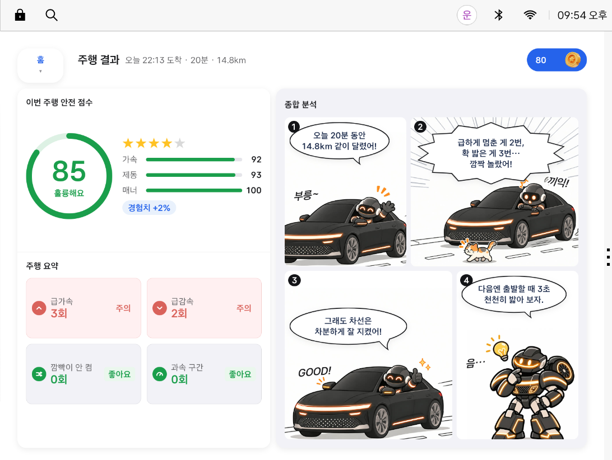
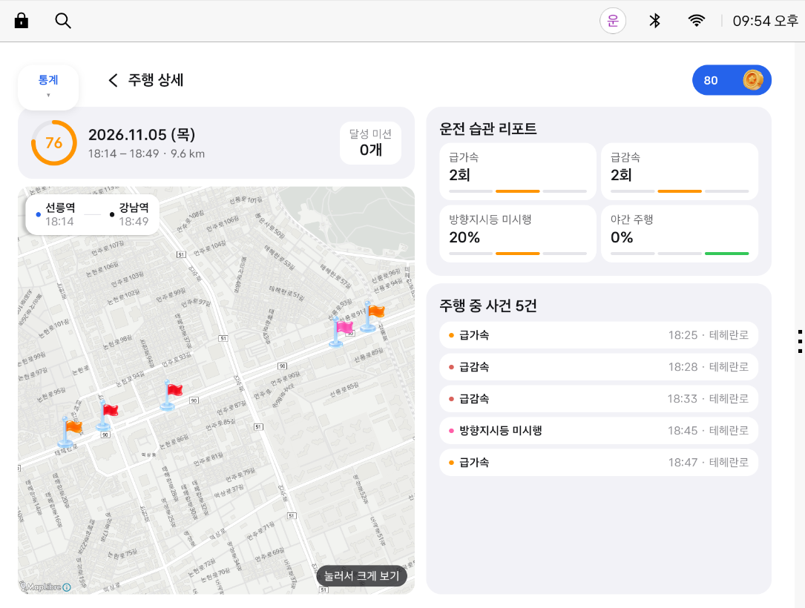

# 차곡 (CHAGOK)
* 앱 화면


* 주행 결과 화면(친근한 피드백)


* 주행기록(감점 지점 지도로 확인 가능)


* 영상 링크
https://github.com/Project-PleosPlayground/chagok/releases/download/v1.0/chagokchagok_chagok_demo.mp4


**운전 습관이 차곡차곡 쌓여 캐릭터가 자라는 차량용 앱.**
2026 현대자동차 차량용 앱 개발 공모전 출품작 (팀 차곡차곡). Pleos Connect(Android Automotive) 기반.

- 주행 중 급가속·급제동·깜빡이 없는 차선 변경·배터리 부족을 차량 신호로 감지해, 캐릭터가 말풍선과 효과음으로 바로 반응합니다.
- 주행이 끝나면 안전 점수와 함께 AI가 그날의 주행을 **4컷 만화**로 정리해 줍니다. 위치·도로명은 서버로 보내지 않습니다.
- 경험치가 쌓이면 캐릭터가 자동차에서 로봇으로 단계별 진화하고, 코인으로 아이템을 사서 꾸밉니다.
- 일일·주간 미션, 지난주 대비 통계, 특정 장소 방문 선물(남산타워·첨성대 등), Gleo 음성 질의 응답을 지원합니다.
- 주행 중에는 CarUxRestrictions에 따라 홈 화면만 보이고, 꾸미기는 정차 중에만 됩니다.

## 실행 방법

APK: [`apk/차곡차곡_차곡_release.apk`](apk/) (release 빌드, 88MB). 같은 파일을 [Releases](../../releases)에도 올려 두었습니다.

```bash
adb install -g apk/차곡차곡_차곡_release.apk
```

- **`-g` 를 꼭 붙여 주세요.** 차량 시스템이 속도 권한을 위치 권한과 한 묶음으로 다뤄서, 권한이 없으면 주행이 기록되지 않습니다. `-g` 없이 설치했다면 첫 실행의 위치 권한 창에서 **허용**을 눌러 주세요.
- 설치하면 **`demo` 프로필**이 준비돼 있습니다: 캐릭터 4단계, 코인 500, 지난 주행 기록 15건, 도전 중인 미션 3개. 프로필 선택 화면에서 `demo` 를 누르면 홈으로 갑니다.
- Virtual Console에서 기어를 **D**로 두고 속도를 올리면 주행이 시작되고, 급제동·깜빡이 없는 차선 변경 등에 캐릭터가 반응합니다. **P**로 바꾸면 잠시 뒤 결과 화면이 나옵니다. 1km·3분 이상 주행하면 점수와 기록이 남습니다.
- AI 4컷 만화는 결과 화면의 만화 아래 **좋아요**(AI 사용 동의)를 누르면 만들어집니다. 인터넷 연결이 필요하고, 연결이 없으면 규칙 기반 문장으로 대신 보여 줍니다.

## 테스트 환경 및 필요한 설정

| 항목 | 값 |
|---|---|
| 에뮬레이터 | **Pleos Connect Emulator v2.1.0** |
| 시스템 이미지 | `system-images;android-34;pleos_car_emulator;arm64-v8a` (Android 14, API 34) |
| 화면 규격 | **2560 × 1440**, 밀도 240dpi (앱은 오른쪽 앱 영역에 표시) |
| AVD 설정 | Cold boot, RAM 4GB |
| 차량 신호 | Pleos Connect Emulator의 Virtual Console (기어·속도·브레이크·조향·방향지시등·배터리) |
| APK ABI | arm64-v8a, x86_64 |
| 앱 요구 | minSdk 28, 인터넷(AI 4컷·원격 콘텐츠, 없으면 기본 동작) |

## 폴더

| 경로 | 내용 |
|---|---|
| `android/` | 앱 코드. `engine/`(안전점수 엔진, 순수 Kotlin) · `core/`(화면 뒤 로직, 순수 Kotlin) · `app/`(Android 앱). [android/README.md](android/README.md) |
| `server/` | AI 중계 서버 (Vercel). 앱 → 서버 → Claude. API 키는 서버 환경변수에만 둡니다 |
| `기획/` | 앱 기획·화면·기능 명세, 안전점수 스펙, 개발 스택 스펙, 디자인 리소스 |
| `scenarios/` | 안전점수 엔진 검증 시나리오 JSON |

## 개발 스택

- Kotlin 2.0, Jetpack Compose (Material 3), Gradle 8.10, JVM 17
- Android Automotive OS (Pleos Connect), minSdk 28, compileSdk 35
- CarPropertyManager, Pleos Vehicle SDK 2.3.2, CarUxRestrictionsManager, Gleo Interface
- AI: Claude API (중계 서버 경유)
- 단위 테스트 1,800여 개 (엔진·도메인·앱, JUnit 5). 엔진과 도메인은 에뮬레이터 없이 검증합니다

## 빌드

```bash
cd android
bash gradlew :engine:test :core:test :app:testDebugUnitTest   # 단위 테스트
bash gradlew :app:assembleDebug                                # 앱 APK
```

AI 중계 서버 주소·토큰은 `android/local.properties` 에 넣습니다 (저장소에는 없음, [android/README.md](android/README.md) 참고). 없으면 AI 대신 규칙 문장으로 동작합니다.
