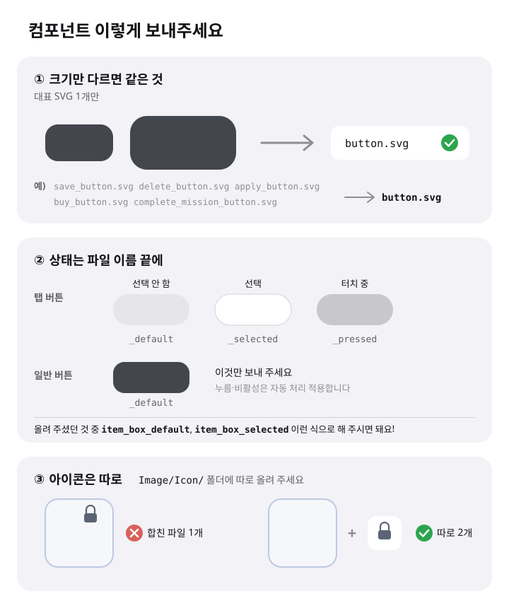

# 디자인 리소스 전달 방법

그림은 이 폴더의 `Image/`에 올리고, 글은 공유 스프레드시트에 적는다. 색·글자 값은 [디자인 시스템](디자인_시스템.md) 4절 팔레트 표와 5절 글자 표에 적는다.

컴포넌트 이름, 상태, 쓰는 곳은 [디자인 시스템](디자인_시스템.md)에 있다. 색·글자·컴포넌트 그림을 한눈에 보려면 [디자인_시스템_보기.html](디자인_시스템_보기.html)을 브라우저로 연다.

## 순서

1. 피그마에서 컴포넌트를 SVG로 내보낸다. 규칙은 "그림 파일" 절.
2. `Image/Component/`에 올린다. 아이콘은 `Image/Icon/`에 올린다.
3. 스프레드시트의 탭을 채운다. 규칙은 [데이터 컬럼 사전](../데이터_컬럼_사전.md).
4. 고친 탭을 CSV로 내보내 `CSV/`의 같은 이름 파일을 덮어쓴다. 색·글자를 바꿀 때는 CSV 대신 디자인 시스템 4·5절 표를 고친다. 빌드는 `CSV/`의 색·폰트 파일을 읽지 않는다.
5. 저장소 맨 위에서 `node 기획/화면/공통/build.js`를 돌린다. 영역 사양과 보기 페이지가 새 색·그림으로 바뀐다. 색·글자를 바꿨으면 앱 테마(`AppPalette.kt`, `AppTypography.kt`)도 같은 값으로 고친다. Claude에게 시켜도 된다.

캐릭터·아이템 그림은 [06_아트_리소스.md](../06_아트_리소스.md)의 규격과 폴더 구조를 따른다.

## 그림 파일

- 이름: 영문 소문자, 숫자, `_`만
- 크기만 다르면 같은 것으로 보고 대표 SVG 1개만
- 버튼: 글자를 빼고 모양만
  - 일반 버튼: `_default` 하나만. 누름·비활성은 자동 처리한다
  - 탭처럼 골라지는 버튼: `_default`(선택 안 함), `_selected`(선택), `_pressed`(터치 중)
- 아이콘: 도형 등 다른 요소와 합치지 말고 따로. `Image/Icon/` 폴더에 올린다
- 카드처럼 앱에서 그릴 컴포넌트도 SVG로 내보낸다. 크기와 색을 거기서 읽는다
- 그림자·흐림: 피그마에 넣은 그대로 내보낸다

예시: [그림파일_좋은예_나쁜예.html](../../자료/그림파일_좋은예_나쁜예.html)

## 스프레드시트

탭마다 컬럼의 뜻, 형식, 적는 규칙은 [데이터 컬럼 사전](../데이터_컬럼_사전.md)에 있다.
